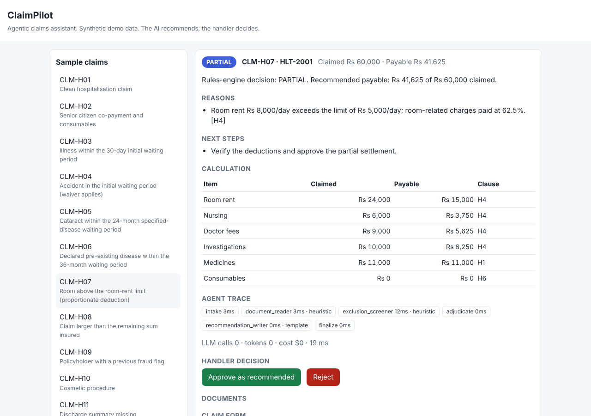
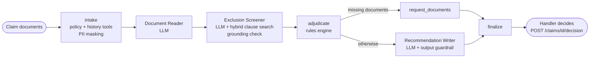

# ClaimPilot: Agentic Claims Processing Assistant

A multi-agent workflow, built with **LangGraph**, that reads insurance claim documents, checks them
against policy rules, customer history and the policy wording, and drafts a recommendation for a
human claims handler. It covers **motor** (own damage and theft) and **health** (hospitalisation)
claims.

> **About this project.** This is a personal demo built from scratch. It is inspired by
> claims-automation work I did for a client, but it contains **no client code, data or documents**.
> All policies, customers, claims and policy wordings in `data/` are synthetic.



## What it does

1. **Intake.** Looks up the policy and claims history (SQL tools), then masks personal data before
   any text reaches a model.
2. **Document Reader agent (LLM).** Extracts structured facts from the claim form, licence, repair
   estimate, FIR, discharge summary and hospital bill.
3. **Exclusion Screener agent (LLM + hybrid search).** Retrieves the relevant policy clauses and
   flags exclusions and waiting periods: drunk driving, mechanical breakdown, cosmetic surgery,
   undeclared pre-existing disease and so on. **Every flag must quote the document word for word**,
   and quotes not found in the documents are discarded.
4. **Rules engine (deterministic).** Decides and computes the amount from the product configuration:
   depreciation bands, deductible, room-rent proportionate deduction, co-payment, waiting periods,
   sum-insured cap, claim frequency and fraud history. The LLM never decides money.
5. **Recommendation Writer agent (LLM).** Writes the handler note with clause citations. A guardrail
   rejects the note if it changes the decision or mentions an amount the rules engine did not produce.
6. **Human in the loop.** Every claim ends as `awaiting_handler`. The handler's decision is final,
   and approved payouts update the claims history. Claims above Rs 3,00,000 are marked for a senior
   handler.

Outcomes: `APPROVE`, `PARTIAL`, `REJECT`, `REFER` (needs investigation) and `REQUEST_DOCUMENTS`.



## Run it

**Docker (recommended)**

```bash
cp .env.example .env          # optional: add OPENAI_API_KEY for the LLM agents
docker compose up --build
```

Open http://localhost:8000 for the handler page, or http://localhost:8000/docs for the API.

Without an API key, the agents run in **offline mode** using deterministic fallbacks, so everything,
including the tests and the evaluation, works with no cost. With a key, the three agents use
`gpt-4.1-mini`. To use **Amazon Bedrock (Nova Pro)** instead, set `LLM_PROVIDER=bedrock` and
`WITH_BEDROCK=true` and use your normal AWS credentials.

**Locally**

```bash
pip install -r requirements-dev.txt
make test        # 75 tests
make eval        # scores all 23 sample claims
make run         # http://localhost:8000
```

## Evaluation

`eval/cases.json` holds 23 claims covering every rule, with the expected decision and payable
amount **worked out by hand** from the policy wordings (the working is in each case's `why`).
`python -m eval.run` scores decision accuracy and exact payable amount, and reports tokens, cost and
latency. CI fails if any case regresses.

| Mode | Decisions | Payable amount |
|---|---|---|
| Offline agents (CI) | 23/23 | 23/23 |

Run `LLM_PROVIDER=openai python -m eval.run --out eval/report_openai.md` to score the LLM agents.

## API

| Method | Path | Purpose |
|---|---|---|
| POST | `/claims` | Process a claim (JSON documents) |
| POST | `/claims/upload` | Process a claim from PDF or text files (scanned PDFs are OCR'd) |
| GET | `/claims`, `/claims/{run_id}` | Results: recommendation, findings, calculation, agent trace, token usage |
| POST | `/claims/{run_id}/decision` | Handler's final decision |
| GET | `/samples` | The synthetic demo claims |

## Tech

Python, FastAPI, LangGraph, OpenAI / Amazon Bedrock (Nova Pro), hybrid retrieval (BM25 + embeddings
with reciprocal rank fusion and reranking), NumPy, SQLite, pdfplumber + Tesseract, Docker, GitHub
Actions, pytest.

## Project layout

```
app/agents/      LangGraph graph, nodes and offline agent fallbacks
app/llm/         provider client (OpenAI, Bedrock, mock), prompts, token and cost tracking
app/retrieval/   clause parsing and hybrid search
app/rules.py     deterministic adjudication
app/guardrails.py  PII masking, grounding check, log scrubbing
app/main.py      FastAPI + handler page
data/            synthetic policies, wordings, product rules and claims
eval/            hand-checked evaluation set and runner
tests/           unit, agent, pipeline and API tests
```

See [DESIGN.md](DESIGN.md) for the design decisions and trade-offs.

## Limitations

- The policy rules are simplified versions of common Indian motor and health terms, written for
  this demo.
- The offline fallback agents read the labelled fields of the demo documents. Messy real-world
  documents need the LLM agents.
- Retrieval is in memory, which suits a few products. A production system would use OpenSearch or
  pgvector.
- SQLite stands in for the core policy and claims systems.
